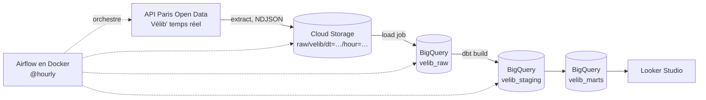

# Vélib' ELT Pipeline — GCP · Airflow · dbt

Pipeline ELT batch de bout en bout : un snapshot horaire de la disponibilité des stations Vélib' (API Paris Open Data, sans clé) est ingéré dans Cloud Storage, chargé dans BigQuery, transformé avec dbt et testé, puis exposé dans un dashboard Looker Studio. L'orchestration tourne avec Airflow en Docker.

## Architecture



| Couche | Contenu |
|---|---|
| `raw` | Snapshots bruts, schéma explicite, partitionnés par jour |
| `staging` | `stg_velib__stations_status` : renommage, typage, dédoublonnage |
| `marts` | `dim_stations`, `fct_station_availability` (incrémental), `mart_station_daily`, `mart_commune_hourly_profile` |

## Choix techniques
- **Idempotence** : chemin GCS déterministe par heure, et suppression de l'heure ciblée avant chaque chargement BigQuery. Un retry ou un rerun ne crée aucun doublon.
- **Schéma explicite** sur la table raw (pas d'autodétection), `ignore_unknown_values` pour absorber les évolutions de l'API.
- **Incrémental dbt** (`insert_overwrite` par partition jour) : seules les 2 derniers jours sont recalculés.
- **Qualité de données** : tests dbt (`not_null`, `unique`, `relationships`, plages de valeurs, unicité composite via `dbt_utils`), tests en `warn` pour les incohérences connues de l'API, contrôle de fraîcheur de la source.
- **dbt isolé dans son propre venv** dans l'image Airflow pour éviter les conflits de dépendances.
- **Coût maîtrisé** : Airflow local plutôt que Cloud Composer, règle de cycle de vie GCS (suppression des fichiers raw après 30 jours). Le volume (~1 500 lignes par heure) reste dans les quotas gratuits BigQuery.
- **Limite connue** : l'API ne fournit que l'état courant, donc pas de backfill (`catchup=False`). L'historique se construit au fil des runs.

## Prérequis
Docker, un compte GCP avec facturation activée (quotas gratuits suffisants), `gcloud` installé.

## Installation

```bash
git clone <ton-repo> && cd velib-elt-gcp
make setup            # crée .env à partir de .env.example
```

### 1. Ressources GCP
```bash
export PROJECT_ID=ton-projet
export BUCKET=${PROJECT_ID}-velib-raw
export SA=velib-elt

gcloud config set project $PROJECT_ID
gcloud storage buckets create gs://$BUCKET --location=EU
gcloud storage buckets update gs://$BUCKET --lifecycle-file=infra/lifecycle.json
bq --location=EU mk -d velib_raw

gcloud iam service-accounts create $SA
gcloud storage buckets add-iam-policy-binding gs://$BUCKET \
  --member=serviceAccount:$SA@$PROJECT_ID.iam.gserviceaccount.com --role=roles/storage.objectAdmin
gcloud projects add-iam-policy-binding $PROJECT_ID \
  --member=serviceAccount:$SA@$PROJECT_ID.iam.gserviceaccount.com --role=roles/bigquery.dataEditor
gcloud projects add-iam-policy-binding $PROJECT_ID \
  --member=serviceAccount:$SA@$PROJECT_ID.iam.gserviceaccount.com --role=roles/bigquery.jobUser

gcloud iam service-accounts keys create secrets/gcp-key.json \
  --iam-account=$SA@$PROJECT_ID.iam.gserviceaccount.com
```
Renseigne ensuite `GCP_PROJECT_ID` et `GCS_BUCKET` dans `.env`. Pense à créer une alerte de budget (5 €) dans la console de facturation.

### 2. Lancer Airflow
```bash
make up               # build + démarrage
# UI : http://localhost:8080 (admin / admin par défaut, voir .env)
make trigger          # premier run manuel
```

### 3. Dashboard
Voir [`docs/dashboard-looker-studio.md`](docs/dashboard-looker-studio.md).

## Développement
```bash
pip install -r requirements-dev.txt
make test             # pytest
make lint             # ruff
```
La CI GitHub Actions exécute ruff, pytest et `dbt parse` à chaque push.

## Structure
```
dags/            DAG Airflow
src/velib/       extraction (API → NDJSON) et chargement (GCS → BigQuery)
dbt/             modèles, tests, sources
tests/           tests unitaires Python
infra/           règle de cycle de vie GCS
docs/            guide du dashboard
```

## Pistes d'évolution
- Provisionner toute l'infra avec Terraform (projet 2 du portfolio)
- Alertes Slack/email sur échec de DAG ou test dbt
- Snapshots dbt (SCD2) sur `dim_stations`
